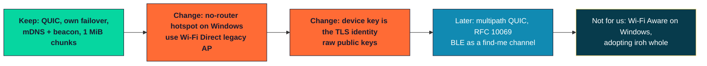

# Relay: next updates

A living file. Updated in the same pull request as the work it describes. The idea agent adds to
the **Ideas** and **Tech watch** sections; only the owner moves an idea into **Planned**.

Last updated: 2026-11-17

## Now

| Item | Phase | Status |
|------|-------|--------|
| Design docs (`docs/design/`) | pre-P0 | Revised after design review, waiting for owner approval |
| Repo skeleton: Rust workspace, one crate per module, CI | P0 | Done |
| Module interfaces for P0 crates, `relay-sim` harness | P0 | Done (interfaces and pure logic only) |
| Agent system files (`CLAUDE.md`, `docs/agent/`) | pre-P0 | Done |
| Test plan and phone plan | pre-P0 | Done (`docs/testing/`, `docs/design/07-android.md`) |
| P0 implementation plan (`docs/plans/2026-11-17-p0-foundation.md`) | P0 | Written, waiting for owner review |
| UI mockup and UI design doc | P2 | Not started (own thread) |
| Tech watch research | pre-P0 | Not started (own thread) |

## Next (P0 to P3, in order)

| # | Update | Phase | Exit test |
|---|--------|-------|-----------|
| 1 | Device identity and fingerprints | P0 | `relay init` prints a stable fingerprint |
| 2 | Wire messages and versioning | P0 | Round-trip tests pass |
| 3 | LAN discovery (mDNS + signed beacon) | P0 | `relay peers` lists the other machine |
| 4 | Encrypted, authenticated session | P0 | `relay ping <peer>` succeeds |
| 5 | `sim` harness: many nodes, scriptable network | P0 | A dropped link can be scripted in a test |
| 6 | Chunked, verified, resumable transfer | P1 | 1 GB file resumes after the app is killed |
| 7 | Site creation and host-approved joins | P2 | Unapproved device sees nothing |
| 8 | Folder grants, browsing, audit log | P2 | Out-of-grant read is refused and logged |
| 9 | Desktop app window (Tauri) | P2 | Approve a join from the window |
| 10 | Multi-path link manager and failover | P3 | Transfer survives Wi-Fi being switched off |
| 11 | Host hotspot mode | P3 | Site works with no router |
| 12 | Host handoff and deputies | P3 | Deputy takes over when the host is shut down |

## Planned after P3

Nothing yet. Items move here from **Ideas** when the owner approves them.

## Ideas (not approved, not scheduled)

Each idea names the impact area it serves (see `docs/design/05-vision.md`).

| Idea | Serves | Size | Added |
|------|--------|------|-------|
| Android app on the same Rust core | All | L | 2026-11-17 |
| Multi-hop relaying between members | Outages, field teams | L | 2026-11-17 |
| Messages and presence | All | M | 2026-11-17 |
| Site dashboard with exportable audit report | All | M | 2026-11-17 |
| Store-and-forward messages for devices that come and go | Outages | M | 2026-11-17 |
| "I'm safe" check-in board and host broadcast notice | Outages | S | 2026-11-17 |
| Low-power mode (slower heartbeats on battery) | Outages | S | 2026-11-17 |
| Folder sync | Field teams | L | 2026-11-17 |
| Transfer queue with priorities and bandwidth limits | Field teams | M | 2026-11-17 |
| Delivery receipts signed by the receiver | Field teams | S | 2026-11-17 |
| Guest role with time-limited membership | Classrooms, events | S | 2026-11-17 |
| One-to-many send | Classrooms, events | M | 2026-11-17 |
| Drop-box folder (write-only grant) | Classrooms, events | S | 2026-11-17 |
| QR-code join | Classrooms, events | S | 2026-11-17 |
| Share one device's internet with the site | Low-connectivity | L | 2026-11-17 |
| Local cache of common files, sync when uplink returns | Low-connectivity | M | 2026-11-17 |
| Bluetooth "find me": a phone finds the site over BLE and receives the Wi-Fi join details | Outages, events | M | 2026-11-17 |
| Pinned site pack: files every member receives on joining (map, contacts, instructions) | Outages, classrooms | S | 2026-11-17 |
| Needs and offers board (water, power, first aid, transport) with host triage | Outages | M | 2026-11-17 |
| Battery-aware handoff: a host on low battery asks its deputy to take over before it dies | Outages | S | 2026-11-17 |
| Carrier mode: a member walking between two sites carries queued messages, with hop limit and expiry | Outages, low-connectivity | L | 2026-11-17 |
| Link forecast before sending: "40 GB on this link takes about 18 minutes" | Field teams | S | 2026-11-17 |
| Watch folder: new files in a folder (camera card, scanner) are sent automatically | Field teams | M | 2026-11-17 |
| Exportable hash manifest per delivery, so a client can re-verify files later | Field teams | S | 2026-11-17 |
| Use two links at once for speed (needs multipath QUIC, see Tech watch) | Field teams | L | 2026-11-17 |
| Collect mode on a drop-box: the host sees who has handed in and who has not | Classrooms, events | S | 2026-11-17 |
| Late-joiner catch-up: a new member gets what was already sent to everyone | Classrooms, events | S | 2026-11-17 |
| End-of-event close: all guest access expires at once and the audit report is exported | Classrooms, events | S | 2026-11-17 |
| Relay spreads Relay: a member can hand the installer to a new device with no internet | Low-connectivity, outages | S | 2026-11-17 |
| Metered-link guard: never push bulk data over a path that costs money unless allowed | Low-connectivity | S | 2026-11-17 |
| Uplink scheduler: queue internet uploads for when the weak uplink is up or idle | Low-connectivity | M | 2026-11-17 |
| Link black box: exportable history of link health and failovers for diagnosis | All | S | 2026-11-17 |
| Post-quantum hybrid handshake (rustls already supports it, see Tech watch) | All | S | 2026-11-17 |
| Demo mode: a built-in script that kills a link on cue and shows the recovery timeline | All (resume demo) | S | 2026-11-17 |

## Tech watch (researched 2026-11-17 by the idea agent)

**Verified** = read in a primary source this session, linked. **Inferred** = my reasoning from
those sources, not stated by them. Nothing here changes the design until the owner or lead says so.

### What the research means, in one picture

Green = current calls hold · orange = proposal for the lead · blue = after P3 · navy = ruled out.

### Findings

| Topic | Answer | Status | What it would replace, and cost | Windows / Android / offline |
|-------|--------|--------|---------------------------------|-----------------------------|
| **Multipath QUIC** | It became a standard this month: [RFC 10069](https://www.rfc-editor.org/info/rfc10069), Proposed Standard, Nov 2026. [quinn 0.11.12](https://docs.rs/crate/quinn/latest) (2026-09-14) does not list it. [noq](https://iroh.computer/blog/iroh-0-97-0-custom-transports-and-noq), a Quinn fork that is "now its own project", adds multipath. | Verified. That upstream quinn lacks it is inferred from its feature list. | Could replace reconnect-on-failover in `link` + `session`. Cost: swap quinn for noq, a younger library. **Recommend: keep our own failover for P3** (it is the resume demo), keep QUIC behind the `session` interface so noq can slot in after P3. | Yes / yes / yes (inferred: QUIC is plain UDP in user space) |
| **Wi-Fi Aware** | Android has it from API 26 and it needs no access point ([Android guide](https://developer.android.com/develop/connectivity/wifi/wifi-aware)). Windows does not support it ([Microsoft Q&A](https://learn.microsoft.com/en-us/answers/questions/2284386/does-windows-have-plans-to-support-wifi-aware), community answer, July 2025). | Android verified. Windows is a community answer, not an official statement, and over a year old. | Nothing. Not usable for a Windows first product. Recheck once a year. | No / yes / yes |
| **Wi-Fi Direct, no router** | Windows can run a Wi-Fi Direct group owner that "acts as an Access Point" with an SSID and passphrase the app sets, so ordinary Wi-Fi devices join it and talk TCP/UDP. Works from a classic desktop app with no manifest ([Microsoft Learn](https://learn.microsoft.com/windows-hardware/drivers/partnerapps/wi-fi-direct), [WiFiDirectLegacySettings](https://learn.microsoft.com/uwp/api/windows.devices.wifidirect.wifidirectlegacysettings)). Android can also be a group owner that legacy clients join ([Android guide](https://developer.android.com/develop/connectivity/wifi/wifi-direct)). | Verified. That it runs with no internet at all is inferred, and needs a 10 minute test on the owner's two PCs. | This is the best fit for **Next #11, host hotspot mode**. It "does not serve as a general-purpose Wi-Fi access point" and cannot run together with Mobile Hotspot. | Yes / yes (joins as normal Wi-Fi) / yes (inferred) |
| **Windows Mobile Hotspot API** | `NetworkOperatorTetheringManager` needs the `wiFiControl` capability and is created **from a connection profile**. Microsoft's sample stops with "Machine isn't connected to the internet" when there is none. Per-session SSID and passphrase need Windows 11 24H2 ([API](https://learn.microsoft.com/uwp/api/windows.networking.networkoperators.networkoperatortetheringmanager), [session config](https://learn.microsoft.com/uwp/api/windows.networking.networkoperators.networkoperatortetheringsessionaccesspointconfiguration)). | Verified. "Unusable offline" is inferred from the sample, not stated outright. | Use it only for the idea "share one device's internet with the site". Do not build the offline hotspot on it. | Yes / n.a. / **likely no** |
| **Rust peer-to-peer libraries** | [iroh 1.0](https://iroh.computer/blog/v1) shipped 2026-06-15 as a first stable release: dial by key, its own QUIC multipath, "local-first" mode that finds local devices "without internet access", official Kotlin bindings. | Verified. | Would replace most of `discovery`, `link`, `session`. **Recommend: do not adopt whole.** It would hide the failover the resume demo is about, and our host-approved certificates would have to sit on top of its identity model. Borrow parts instead (noq, verified streaming). | Yes / yes / yes |
| **Discovery library** | [mdns-sd 0.21.7](https://docs.rs/crate/mdns-sd/latest) (2026-11-02) supports Windows, macOS, Linux, runs its own thread, needs no async runtime, calls itself "still beta". Android is not listed. | Verified. | Fits the current call (mDNS + signed beacon). Android keeps using NSD as `07-android.md` already says. | Yes / not listed / yes |
| **Device key as TLS identity** | [rustls 0.23.46](https://docs.rs/rustls/latest/rustls/manual/_04_features/index.html) supports "RFC7250 raw public keys for TLS1.3" and post-quantum hybrid key exchange (X25519MLKEM768). | Verified for rustls. How cleanly quinn exposes raw keys is **not checked**. | Replaces generating a self-signed certificate per device. One key, one identity, less code in `identity`. Cost: small, decide before P0 item 4. | Yes / yes / yes |
| **Chunking and resume** | [iroh-blobs](https://docs.iroh.computer/protocols/blobs/) uses BLAKE3 "verified streaming": one 32 byte root hash verifies any byte range, with resumable range downloads. | Verified. | Would replace the per-chunk hash list in the offer. **Recommend: keep the 1 MiB list for P1** (32 KB per GB is fine, and it is simpler to test). Revisit for folder sync. Content-defined chunking for dedupe was not researched. | Yes / yes / yes |
| **Bluetooth** | BLE is for "small amounts of data"; Android 12+ needs runtime permissions `BLUETOOTH_SCAN`, `ADVERTISE`, `CONNECT` ([overview](https://developer.android.com/develop/connectivity/bluetooth/ble/ble-overview), [permissions](https://developer.android.com/develop/connectivity/bluetooth/bt-permissions)). [btleplug 0.13.5](https://docs.rs/crate/btleplug/latest) covers Windows and Android but is "host/central mode only", so it cannot advertise. | Verified. | Adds a side channel, replaces nothing: find a site and hand over Wi-Fi join details. Never for file data. Advertising needs platform code. **Needs an owner yes: is Bluetooth inside "standard radios only"?** | Yes / yes / yes |
| **Tauri on Android, background** | [tauri-plugin-background-service 1.0.1](https://docs.rs/crate/tauri-plugin-background-service/latest) (2026-07-30) wraps an Android foreground service. It notes the Android 15 `dataSync` 6 hour limit and that "OEM battery optimization may kill services". | Verified. "Young, one maintainer, first release April 2026" is my reading of its release list. | Could save writing the Kotlin service by hand. The rules in `07-android.md` (resume from disk, `pause_all`) already cover its limits. | n.a. / yes / yes |
| **Store-and-forward and mesh, prior art** | [Bundle Protocol v7, RFC 9171](https://www.rfc-editor.org/info/rfc9171) is the standard model for delay-tolerant delivery. [bitchat](https://github.com/permissionlesstech/bitchat) shows a phone-only BLE mesh: Noise encryption, relay "max 7 hops", queued messages. | Verified. | Nothing now. Borrow two ideas for the roadmap: a hop limit and a time-to-live on every relayed message. | n.a. |

### Proposals for the lead (I cannot edit design docs)

1. **Next #11 hotspot:** build the Windows no-router mode on the Wi-Fi Direct legacy access point,
   not Mobile Hotspot. Needs one hardware test first.
2. **P0 item 4 session:** use raw public keys so the Ed25519 device key is the TLS identity. Check
   quinn's support before committing.
3. **Session interface:** keep QUIC library types out of the `session` public interface, so a
   multipath library can replace quinn after P3 without touching `transfer`.

### Still open

| Question | Why it matters |
|----------|----------------|
| Does the Wi-Fi Direct legacy AP start with no internet on the owner's PCs and Wi-Fi cards? | Decides Next #11 |
| Does quinn expose rustls raw public keys without custom verifier code? | Decides proposal 2 |
| Can Windows and Android pair with true Wi-Fi Direct (not the legacy AP route)? | Only matters if the legacy route fails |
| rust-libp2p as an alternative to iroh | Not researched; low priority given the recommendation above |
| Content-defined chunking (dedupe) for folder sync | Only matters when folder sync is planned |

## Library candidates

Versions and dates as read on 2026-11-17. "Fit" is my recommendation, not a decision.

| Library | For module | Version, date | Fit | Note |
|---------|-----------|---------------|-----|------|
| [quinn](https://docs.rs/crate/quinn/latest) | session | 0.11.12, 2026-09-14 | Use for P0 | Mature QUIC. No multipath listed. |
| [rustls](https://docs.rs/rustls/latest/rustls/manual/_04_features/index.html) | session, identity | 0.23.46, 2026-10-14 | Use for P0 | Raw public keys, post-quantum hybrid available. |
| [mdns-sd](https://docs.rs/crate/mdns-sd/latest) | discovery | 0.21.7, 2026-11-02 | Use for P0 on desktop | "Still beta". Android not listed. |
| [noq](https://github.com/n0-computer/noq) | session, link | not checked | Watch, after P3 | Quinn fork with multipath. Crate publishing status not checked. |
| [iroh](https://iroh.computer/blog/v1) | discovery, link, session | 1.0, 2026-06-15 | Do not adopt whole | Good reference design. |
| [iroh-blobs](https://docs.iroh.computer/protocols/blobs/) | transfer | version not stated | Watch, for folder sync | Verified streaming from one root hash. |
| [btleplug](https://docs.rs/crate/btleplug/latest) | discovery | 0.13.5, 2026-10-10 | Only if Bluetooth is approved | Central role only; 0.13.0 was yanked. |
| [tauri-plugin-background-service](https://docs.rs/crate/tauri-plugin-background-service/latest) | node (Android) | 1.0.1, 2026-07-30 | Evaluate at Android step 1 | Young project. |
| Windows `WiFiDirect` WinRT API | link | Windows 10+ | Use for Next #11 | [Legacy AP mode](https://learn.microsoft.com/uwp/api/windows.devices.wifidirect.wifidirectlegacysettings). |

## Changelog

| Date | Change |
|------|--------|
| 2026-11-17 | File created. Stack chosen: Rust core + Tauri app. Design docs drafted. |
| 2026-11-17 | Workspace skeleton, P0 interfaces, sim harness, agent files, test plan, phone plan added. |
| 2026-11-17 | Protocol revised after design review: commit-then-reveal join code, deputy certificates bound to host and epoch, failover at Suspect with warm standby, per-chunk hash list, signed audit checkpoints, trust policy pushed down into session. |
| 2026-11-17 | P0 implementation plan written: 10 tasks, library versions checked on crates.io. |
