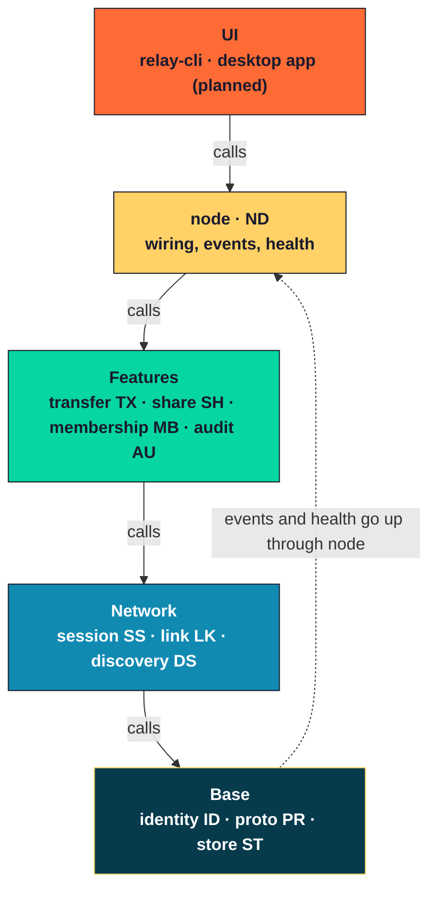
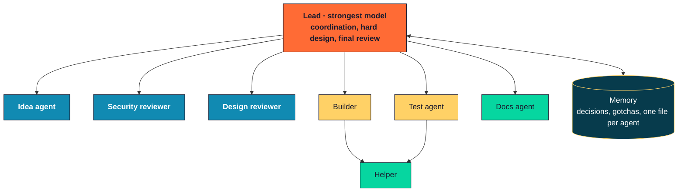

# Relay

A portable, self-healing local network with file transfer for one site: a home, an office, an
event, or a field team. It works with no internet. If a link drops, traffic moves to another link.
If the host drops, an owner-approved device takes over.

- The host approves every join. The owner approves host handoff.
- Folder browsing needs a per-folder grant and every access is audit-logged.
- Windows first, then Android. Rust core, Tauri app.

**Status:** design drafted and waiting for owner approval. The Rust workspace, module interfaces,
`sim` test harness, and CI exist. The `relay` commands that touch the network are not built yet.
See [`NEXT-UPDATES.md`](NEXT-UPDATES.md) for what is in progress.

## Architecture

One crate per module. Each module owns one job and one error prefix (`RLY-<MODULE>-<N>`), so a
failure names the module it came from. Modules depend **downward only**.



| Layer | Modules | Job |
|-------|---------|-----|
| UI | `relay-cli`, desktop app (planned) | Show state, collect approvals |
| Node | `node` | Start modules, route events, report health |
| Features | `transfer`, `share`, `membership`, `audit` | Files, folder grants, joins and handoff, the log |
| Network | `session`, `link`, `discovery` | Encrypted connections, paths and failover, finding peers |
| Base | `identity`, `proto`, `store` | Keys and certificates, wire messages, local files |

`relay-common` (shared IDs and error codes) sits under everything. `relay-sim` is the test harness
that runs several nodes in one process with a scriptable network.

Full module map and rules: [`docs/design/01-architecture.md`](docs/design/01-architecture.md).

## Agent hierarchy

One agent system works on the whole repo. It loads a module's playbook, checklists, and memory
before touching that module. A task goes to the cheapest tier that can do it safely.



Orange = lead · blue = strong model · yellow = mid model · green = cheapest model. Every agent
reads memory before work and writes to it after.

Entry point and router table: [`CLAUDE.md`](CLAUDE.md). Full design:
[`docs/design/04-agent-system.md`](docs/design/04-agent-system.md).

## Contributor quickstart

You need Rust 1.80 or newer (`rustup` installs it).

```
git clone https://github.com/ShagnikPal123/Networking-Project
cd Networking-Project
cargo test --workspace
cargo run -p relay-cli -- health
```

`health` prints one light per module:

```
ID ●  PR ●  ST ●  DS ●  LK ●  SS ●  MB ●  TX ●  SH ●  AU ●  ND ●
```

To make a change:

1. Pick **one** module. Read its playbook in [`docs/agent/modules/`](docs/agent/modules/).
2. Follow the [basic checklist](docs/agent/checklists/basic.md). If the change touches keys, a
   wire message, a public interface, failover, or disk, also follow the
   [advanced checklist](docs/agent/checklists/advanced.md).
3. Write the failing test first. Give every new failure an `RLY-<MODULE>-<N>` code.
4. Run what CI runs, on a branch:

   ```
   cargo fmt --all -- --check
   cargo clippy --workspace --all-targets -- -D warnings
   cargo test --workspace
   ```

5. Open a pull request and add a line to [`NEXT-UPDATES.md`](NEXT-UPDATES.md) in the same PR.

## Where things are

| Path | What |
|------|------|
| [`docs/design/`](docs/design/00-overview.md) | Overview, architecture, protocol, phases P0 to P3, agent system, vision, Android plan |
| [`docs/testing/test-plan.md`](docs/testing/test-plan.md) | How each phase is tested |
| [`docs/agent/`](docs/agent/) | Agent playbooks, checklists, and memory |
| [`crates/`](crates/) | One crate per module, plus `relay-common`, `relay-sim`, `relay-cli` |
| [`NEXT-UPDATES.md`](NEXT-UPDATES.md) | Living roadmap and changelog |

License: MIT (declared in `Cargo.toml`).
