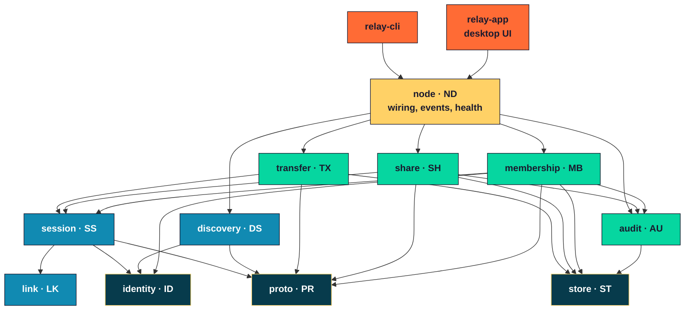
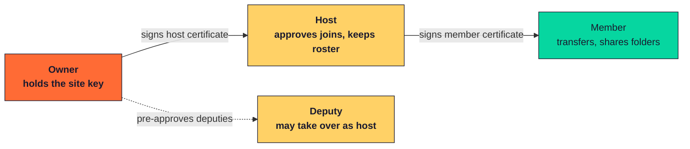

# Relay: architecture and module boundaries

Status: **draft for approval** · 2026-11-17

## The rule

Each module owns one job, one error-code prefix, and one log target. Modules only depend
**downward** in the diagram. If something breaks, the error code names the module.



Layers, top to bottom: **UI** (orange) · **node** (yellow) · **features** (green) ·
**network** (blue) · **base** (navy).

## Modules

| Code | Module | Owns | Must never |
|------|--------|------|-----------|
| ID | identity | Device keys, site keys, certificates, chain checks | Touch the network or disk paths it was not given |
| PR | proto | Message types, encoding, version numbers | Do any I/O |
| ST | store | Local files: config, roster, transfer state | Know what the data means |
| DS | discovery | Finding sites and peers on the LAN | Decide who is trusted |
| LK | link | Network interfaces, paths to a peer, probing, picking the best path | Read or interpret payloads |
| SS | session | One encrypted, authenticated connection per peer; reconnect and resume | Know about files or folders |
| MB | membership | Join requests, approvals, roster, host certificate, handoff | Move file data |
| TX | transfer | Manifests, chunks, verify, resume | Decide access rights |
| SH | share | Folder grants, directory listing, access checks | Skip the audit write |
| AU | audit | Append-only, hash-chained log | Edit or delete entries |
| ND | node | Starts modules, routes events, reports health | Contain protocol logic |
| UI | cli / app | Showing state, collecting approvals | Bypass node to call modules |

`relay-common` sits under everything: module tags, error codes, health states, and the shared ID
types (`DeviceId`, `SiteId`, `Epoch`). It has no logic and no error prefix of its own.

## How modules talk

- **Calls go down** through small public interfaces (one interface file per module).
- **News goes up** as events on a bus owned by `node` (`PeerFound`, `PathDown`, `JoinRequested`,
  `ChunkVerified`, `HostChanged`...). A module never calls a module above it.
- **Rules go down as snapshots.** When a lower module needs a decision owned by a higher one, the
  higher module hands down a snapshot or policy object. Example: `session` must reject removed
  devices, so `membership` pushes the current roster and revocation list down into `session`'s
  trust policy. `session` never asks `membership` anything.
- A module that fails reports `Degraded` or `Down` to `node`. Modules that do not depend on it keep
  running. Example: if `discovery` is down, existing sessions and transfers continue.

## Error codes

Format: `RLY-<MODULE>-<NUMBER>`, for example `RLY-LK-003 no usable path to peer`.

- Each module defines its own error list. Errors from below are **wrapped**, never renamed, so the
  original code survives to the UI and the log.
- The UI shows a health strip: one light per module (ok / degraded / down) plus the last code.

```
 ID ●  PR ●  ST ●  DS ●  LK ◐  SS ●  MB ●  TX ●  SH ●  AU ●
                          └─ RLY-LK-003 Wi-Fi path lost, using Ethernet
```

## Roles



- **Owner:** created the site. The only one who can name a host or deputies. Often the owner is
  also the first host.
- **Host:** the device currently approving joins and publishing the roster.
- **Deputy:** a member the owner has pre-approved to become host if the host disappears.
- **Member:** any approved device.

## Testing boundaries

- Every module has unit tests that run with no network (fake clock, in-memory transport).
- A `sim` test harness runs several nodes in one process with a scriptable network (drop a link,
  add delay, kill a node). All P3 failover behavior is tested here first, then on real machines.
