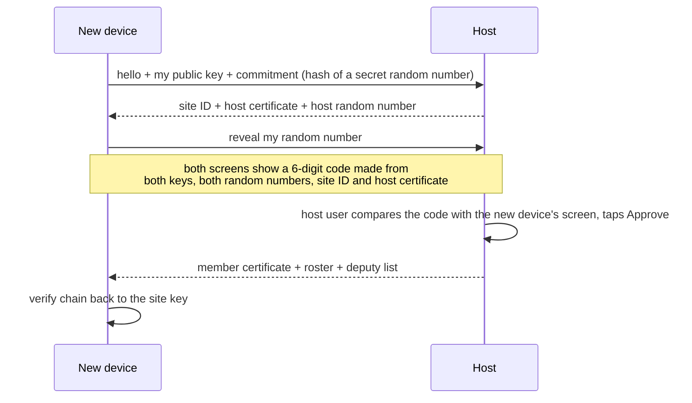
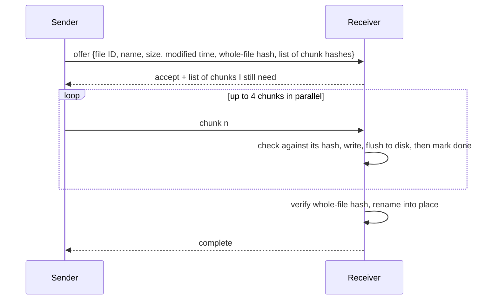
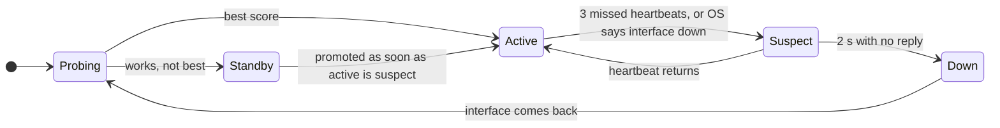

# Relay: protocol mechanics

Status: **draft for approval** · 2026-11-17 · revised after design review · Items marked
**(call)** are proposals.

## 1. Identity and trust (module ID)

- Every device makes an **Ed25519 key pair** on first run. Its **device ID** is a hash of the
  public key, shown to people as a short fingerprint like `K7QF-2M9X`.
- Creating a site makes a **site key pair**. Whoever holds it is the **owner**.
- The site key lives only on the owner's device, protected by the operating system's key store. The
  owner is prompted to save an encrypted **recovery file** when the site is created, because a lost
  site key means nobody can ever name a new host **(call)**.
- Trust is a chain of signed certificates. Any member can check it offline.

```
site key (owner) ──signs──▶ host certificate   {site, host device, epoch, expiry}
site key (owner) ──signs──▶ deputy certificate {site, deputy device, replaces host H at epoch E}
host key         ──signs──▶ member certificate {site, device, name, expiry}  (+ the host cert that issued it)
```

- **Epoch** is a counter that goes up by one at every host change. Higher epoch always wins.
- **Member certificates survive a host change.** Each one carries the host certificate that issued
  it, so the chain still verifies. They last 30 days and renew quietly whenever the device sees the
  current host **(call)**.
- **Removing a device:** the host signs a numbered **revocation list**. Every member keeps a copy of
  the roster and revocation list, and two members compare list numbers whenever a session opens and
  pass on the newer one. A removed device is locked out as each member hears the news, and at the
  latest when its certificate expires.

## 2. Discovery (module DS)

Two methods run together, because mDNS is often blocked on Windows networks **(call)**:

1. **mDNS** service `_relay._udp.local`.
2. **UDP broadcast beacon** every 2 s: `{beacon version, site tag, device ID, port}`, signed by the
   device key. The site tag is all zeros before the device belongs to a site, so the same format
   works in P0 and later.

Fallback: type an address or scan a QR code.

Discovery only says "something is here". It never grants trust. Who the host is, the epoch, and the
roster are **not** in the beacon; they travel only inside authenticated sessions.

**What an outsider on the same network can learn:** that Relay devices exist, their addresses, and
their device IDs. Not names, roles, the roster, or anything about files.

## 3. Joining (module MB)



- **Commit first, reveal second.** The new device locks in its random number before it sees the
  host's. A device in the middle cannot keep trying keys until the codes match, so 6 digits are
  enough.
- The code also covers the site ID and host certificate, so the new device is sure it is joining
  the site on the host's screen and not a look-alike.
- Until approved, a device gets only the site ID and host certificate. No roster, no deputy list,
  no file lists.
- Approvals and denials are written to the audit log.

## 4. Sessions (module SS)

- Transport is **QUIC over UDP** **(call)**: encrypted by default (TLS 1.3), many independent
  streams on one connection, no head-of-line blocking between files.
- Both sides prove they hold their device keys. Session then asks a **trust policy** whether this
  peer is allowed. The policy is handed down to session from above, so session never calls upward:

| Phase | Trust policy |
|-------|--------------|
| P0, P1 | The peer's fingerprint is on the local pinned list (`relay trust <fingerprint>`). |
| P2 on | The peer shows a member certificate whose chain reaches the site key, not expired, not on the revocation list. Membership pushes fresh snapshots of the roster and revocation list down as they change. |

- Each peer pair has one **session** with a session ID. A session outlives any single connection.
- Stream types: one **control** stream (small messages) and many **data** streams (file chunks).
- Messages are length-prefixed binary frames, each with a type and version. Unknown types are
  skipped, so old and new versions can talk.

## 5. File transfer (module TX)



- Chunks are **1 MiB** **(call)**, hashed with **BLAKE3**. The offer carries **every chunk's hash**
  (32 bytes per chunk, about 32 KB per GB), so each chunk is checked the moment it arrives.
- A chunk is marked done only **after** its bytes are flushed to disk, so a power cut can never
  leave the map claiming a chunk that is not there.
- The map lives next to a `.relaypart` file. After a link drop, app restart, or reboot, the receiver
  asks only for missing chunks.
- On resume the sender re-checks the file's size and modified time. If the source changed, the
  transfer restarts cleanly instead of mixing two versions.
- A file appears under its real name only after the whole-file hash matches.

## 6. Link failover (module LK) — the resume demo

A **path** is one (local interface, peer address) pair. The link module keeps every path it can
find to each peer and scores them.



Failover budget (target: **data flowing again in under 3 seconds, zero corrupt or lost bytes**):

```
0 ms        250       500       750 ms                     ~1.0 to 1.5 s
 │ link dies │ miss 1  │ miss 2  │ miss 3 → SUSPECT          │ data flowing on standby
 │           │         │         │ switch to standby now     │
 └───────────┴─────────┴─────────┴───────────────────────────┘
   If Windows reports the interface down, skip straight to the switch.
```

- Heartbeat every 250 ms on the active path, every 1 s on standby paths **(call)**.
- **The switch happens at Suspect, not at Down.** Waiting for Down would use 2.75 s of the 3 s
  budget just to notice.
- **Standby paths are kept warm:** the session holds an open, already-authenticated connection on
  the best standby path, so switching is "send on the other connection", not a new handshake.
- If the old path recovers, it becomes the standby. No flapping back unless it scores clearly
  better for 5 s.
- Score = reachable, then lowest loss, then lowest delay, then wired before wireless.
- The link module never looks inside payloads. It only answers "which path now?".

Links in scope: Ethernet, Wi-Fi on a shared router, and a hotspot (the host PC's or a phone's) so a
site works with no router. Known limit to confirm on the bench: a PC's own hotspot uses its Wi-Fi
radio, so "Wi-Fi off" may take the hotspot with it. The demo's guaranteed case is **Wi-Fi drops,
Ethernet takes over**; the phone hotspot is the third path.

## 7. Host handoff (module MB)

Two cases, both owner-approved:

```
Planned                                 Unplanned (host vanished)
───────                                 ─────────────────────────
owner picks new host                    host silent for 10 s
owner signs host cert, epoch E+1        first reachable deputy on the owner's list
owner signs fresh deputy certs          presents its deputy cert: "replaces host H at epoch E"
  naming the NEW host at E+1            becomes host at E+1, members switch
old deputy certs are now useless        owner is told when next seen, re-issues deputy certs
```

- **Deputies are the owner's approval given in advance** **(call)**. Each deputy certificate names
  the exact host and epoch it may replace. After any handoff, old deputy certificates no longer
  match, so a planned handoff can never be hijacked by a deputy.
- Every member already holds the roster and revocation list (section 1), so a deputy can start
  hosting immediately.
- With no deputies named, an unplanned host loss pauses new joins until the owner acts. Existing
  members keep transferring, since sessions are peer to peer.
- If two deputies both step up, the one earlier in the owner's list wins; the other steps down.

## 8. Folder browsing (modules SH and AU)

- The device that holds the files is the only place access is checked.
- A **grant** is `{folder, who (one device or all members), read-only, expiry}`. No grant, no
  listing. Nothing is shared by default.
- Every request path is resolved and checked to be inside the granted folder before use (blocks
  `..` and link tricks).
- Every list, read, and denial is appended to the **audit log** on the sharing device: one JSON
  line per event, each carrying the hash of the line before it.

```
{"n":41,"t":"2026-11-17T02:20:11Z","who":"K7QF-2M9X","act":"list","path":"Photos/2026","ok":true,"prev":"9f2c…"}
{"n":42,"t":"2026-11-17T02:20:15Z","who":"K7QF-2M9X","act":"read","path":"../Taxes","ok":false,"prev":"b81a…"}
```

- Every 50 entries and at shutdown, the device **signs the latest line's hash** with its device key
  and sends that checkpoint to the host **(call)**. So:
  - edits or deletions by anyone without the device key are detected (signature fails);
  - cutting off the end is detected (the host holds a later checkpoint).
- Honest limit: the device's own user could rewrite entries made since the last checkpoint. That
  fits the friendly-site model and is stated, not hidden.

## 9. System settings

Relay **never changes a computer's settings silently**. Adding a firewall rule for its UDP port or
starting a hotspot is always a visible prompt that explains why, and Relay keeps working in a
reduced way (manual address entry) if the user says no.

## 10. Threats covered

Trust model: a **friendly site**. Protect against outsiders and mistakes, not hostile members.

| Threat | Answer |
|--------|--------|
| Stranger on the same Wi-Fi listens in | All traffic is encrypted; discovery reveals only device IDs and addresses |
| Stranger pretends to be the host | Host certificate must be signed by the site key |
| Device in the middle during join | Commit-then-reveal 6-digit code covering keys, site ID, host certificate |
| Look-alike site | The code on the host's screen will not match |
| Removed device comes back | Revocation list passed between members, 30-day certificate expiry |
| Old deputy hijacks a planned handoff | Deputy certificates name the host and epoch they replace |
| Member reaches outside a granted folder | Path check on the sharing device, logged denial |
| Corrupt data in transit or on disk | Per-chunk hashes on arrival, whole-file hash at the end, flush before mark |
| Someone edits or trims the audit log | Signed checkpoints held by the host |

Out of scope for P0 to P3: a hostile owner or member, a compromised operating system, radio
jamming.
