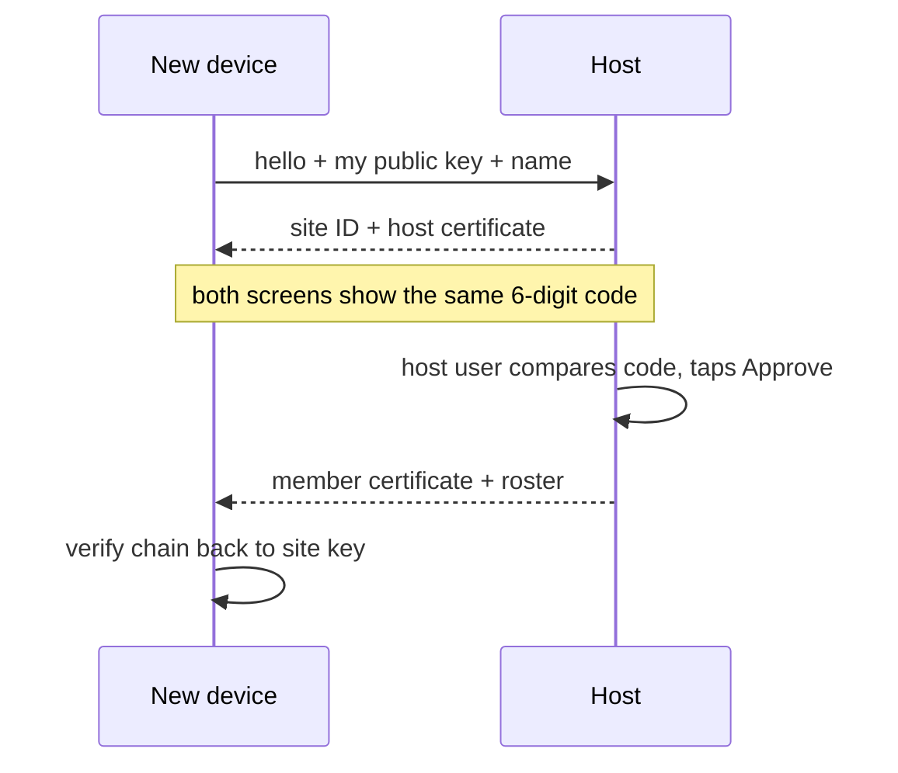
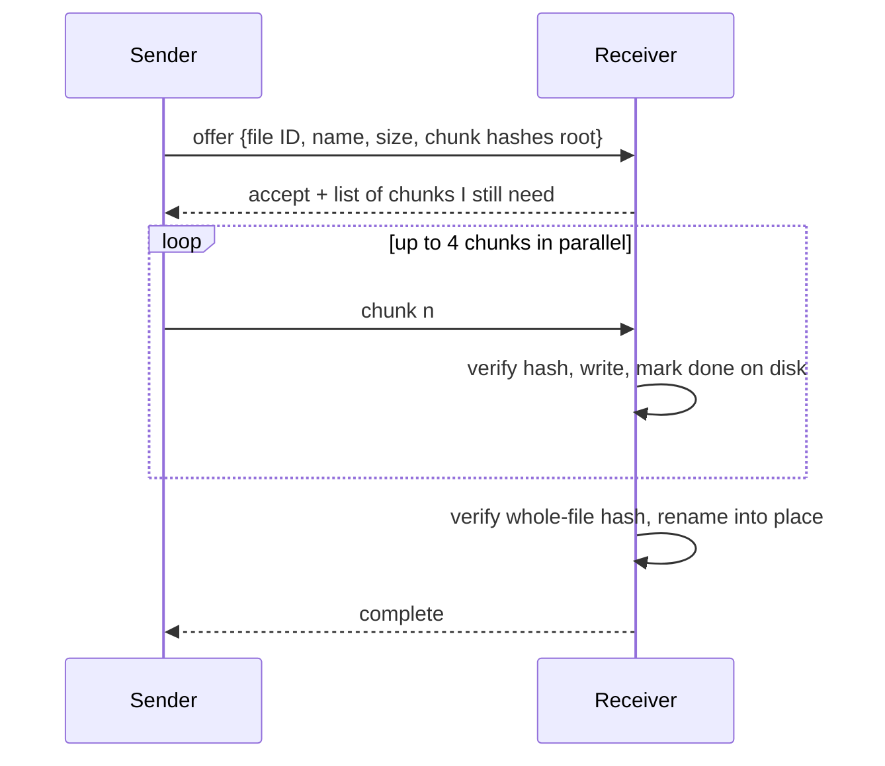
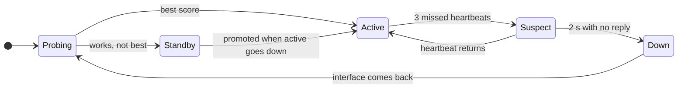

# Relay: protocol mechanics

Status: **draft for approval** · 2026-11-17 · Items marked **(call)** are proposals.

## 1. Identity and trust (module ID)

- Every device makes an **Ed25519 key pair** on first run. Its **device ID** is a hash of the
  public key, shown to people as a short fingerprint like `K7QF-2M9X`.
- Creating a site makes a **site key pair**. Whoever holds it is the **owner**.
- Trust is a chain of three signed certificates. Any member can check it offline.

```
site key (owner) ──signs──▶ host certificate {site, host device, epoch, deputies[], expiry}
host key         ──signs──▶ member certificate {site, device, name, epoch, expiry}
```

- **Epoch** is a counter that goes up by one at every host change. Higher epoch always wins, which
  settles any "two hosts" confusion.
- Removing a device: the host publishes a signed **revocation list** with the roster.

## 2. Discovery (module DS)

Two methods run together, because mDNS is often blocked on Windows networks **(call)**:

1. **mDNS** service `_relay._udp.local`.
2. **Signed UDP broadcast beacon** every 2 s: `{site ID, host device ID, epoch, port}`.

Fallback: type an address or scan a QR code. Discovery only says "something is here". It never
grants trust.

Beacon details (built in `relay-discovery`, layout in `crates/relay-discovery/src/wire.rs`):

- **Port 47470** by default **(call)**. It is a setting (`BeaconConfig`), not a fixed value.
- **Signing goes through hooks** **(call)**. The node hands discovery a signer and a verifier
  (`BeaconSigner`, `BeaconVerifier`) backed by the identity module. Discovery never holds a
  secret key.
- One fixed 176-byte datagram. Anything else is dropped: wrong size, wrong version, bad
  signature, a key that does not belong to the named host, or the device's own beacon.
- A sighting is the sender's IP address plus the session port from the beacon.

## 3. Joining (module MB)



- The 6-digit code is derived from both public keys and the handshake, so a device in the middle
  cannot fake it.
- Until approved, a device gets nothing else: no roster, no file lists.
- Denials and approvals are written to the audit log.

## 4. Sessions (module SS)

- Transport is **QUIC over UDP** **(call)**: encrypted by default (TLS 1.3), many independent
  streams on one connection, no head-of-line blocking between files.
- Both sides authenticate with their device keys, then exchange member certificates. A peer with no
  valid chain is dropped.
- Each peer pair has one **session** with a session ID. A session outlives any single connection:
  if the connection dies, the session reconnects on any working path and carries on.
- Stream types: one **control** stream (small messages) and many **data** streams (file chunks).
- Messages are length-prefixed binary frames, each with a type and version. Unknown types are
  skipped, so old and new versions can talk.

## 5. File transfer (module TX)



- Chunks are **1 MiB** **(call)**, hashed with **BLAKE3**.
- The receiver keeps a "chunks done" map on disk next to a `.relaypart` file. After a link drop, an
  app restart, or a reboot, it asks only for the missing chunks.
- A file appears under its real name only after the whole-file hash matches. A bad chunk is
  re-requested, never kept.

## 6. Link failover (module LK) — the resume demo

A **path** is one (local interface, peer address) pair. The link module keeps every path it can
find to each peer and scores them.



- Heartbeat every 250 ms on the active path, every 2 s on standby paths **(call)**.
- Score = reachable, then lowest loss, then lowest delay, then wired before wireless.
- When the active path goes down, the session reconnects on the best standby path. Transfers resume
  from their chunk maps. **Target: data flowing again in under 3 seconds, zero corrupt or lost
  bytes.**
- The link module never looks inside payloads. It only answers "which path now?".

Links in scope: Ethernet, Wi-Fi on a shared router, and a **hotspot run by the host** so a site
works with no router at all.

## 7. Host handoff (module MB)

Two cases, both owner-approved:

```
Planned                                 Unplanned (host vanished)
───────                                 ─────────────────────────
owner picks new host                    host silent for 10 s
owner signs host cert, epoch+1          first reachable deputy on the owner's list
roster moves, members switch            presents its pre-signed cert, epoch+1
                                        members switch; owner is told when next seen
```

- **Deputies are the owner's approval given in advance** **(call)**. The owner signs a certificate
  per deputy ahead of time that only becomes valid at `epoch+1`. This is how the network heals
  while the owner is offline without breaking "owner approves handoff".
- With no deputies named, an unplanned host loss pauses new joins until the owner acts. Existing
  members keep transferring, since sessions are peer to peer.
- If two deputies both step up, the one earlier in the owner's list wins; the other steps down.

## 8. Folder browsing (modules SH and AU)

- The device that holds the files is the only place access is checked.
- A **grant** is `{folder, who (one device or all members), read-only, expiry}`. No grant, no
  listing. Nothing is shared by default.
- Every request path is resolved and checked to be inside the granted folder before use (blocks
  `..` and link tricks).
- Every list, read, and denial is appended to the **audit log** on the sharing device: one JSON
  line per event, each line carrying the hash of the line before it, so edits or deletions are
  detectable.

```
{"n":41,"t":"2026-11-17T02:20:11Z","who":"K7QF-2M9X","act":"list","path":"Photos/2026","ok":true,"prev":"9f2c…"}
{"n":42,"t":"2026-11-17T02:20:15Z","who":"K7QF-2M9X","act":"read","path":"../Taxes","ok":false,"prev":"b81a…"}
```

## 9. Threats covered

| Threat | Answer |
|--------|--------|
| Stranger on the same Wi-Fi listens in | All traffic is encrypted; discovery reveals only that a site exists |
| Stranger pretends to be the host | Host certificate must be signed by the site key |
| Device in the middle during join | 6-digit code comparison |
| Removed device comes back | Revocation list, certificate expiry |
| Member reaches outside a granted folder | Path check on the sharing device, logged denial |
| Corrupt data in transit or on disk | Per-chunk and whole-file hashes |
| Someone edits the audit log | Hash chain breaks |

Out of scope for P0 to P3: a malicious owner, a compromised operating system, radio jamming.
