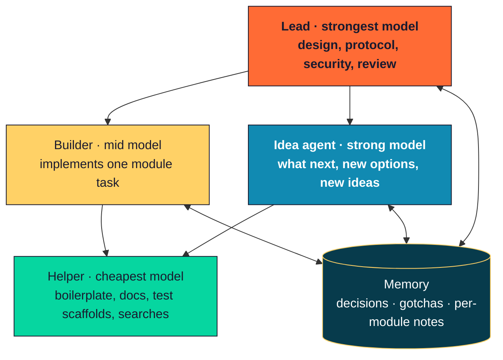

# Relay: the agent system

Status: **draft for approval** · 2026-11-17

One system works on the whole repo. It behaves differently per module because it loads that
module's playbook, checklists, and memory before touching it.



## Who does what

| Tier | Use for | Never for |
|------|---------|-----------|
| Lead (strongest) | Anything touching identity, session, membership, link failover; design changes; final review | Renames, formatting |
| Builder (mid) | A scoped task inside one module with a written plan | Changing a module's public interface on its own |
| Helper (cheapest) | Boilerplate, doc updates, test scaffolds, finding files | Security or protocol logic |

| Idea agent (strong) | Keeping `NEXT-UPDATES.md` and `05-vision.md` current; researching new options | Editing code or approved design docs |

A task always goes to the cheapest tier that can do it safely. Work flows down; results are checked
on the way back up.

## Splitting work

Any agent may ask for sub-agents, but it must **propose the split first** and wait for a yes:

1. List the pieces, which tier each needs, and which files each piece owns.
2. No two pieces may own the same file. Shared files (workspace manifest, `proto` types) are
   written by the requester before the split starts.
3. The requester checks every result against the checklists before merging it.

Lead proposes splits to the owner. Builders and the idea agent propose splits to the lead.

## The idea agent

Its own module of the agent system, with its own playbook, checklists, and memory.

- **Job:** know what should change next, track the newest relevant technology, and keep adding
  ideas tied to a real impact area.
- **Writes to:** `NEXT-UPDATES.md` (Ideas, Tech watch, Changelog) and proposals for `05-vision.md`.
- **Cannot:** move an idea to Planned (owner only), change P0 to P3 scope, or touch code.
- **Runs:** at the end of each phase, and whenever the owner asks.

Idea agent basic checklist:

1. Read `NEXT-UPDATES.md`, `05-vision.md`, and `memory/ideas.md` (past ideas, including rejected
   ones and why).
2. Update **Now** and **Next** to match what actually merged.
3. For each new idea: name the impact area, the user it helps, and a rough size. No area, no idea.
4. Do not re-propose a rejected idea unless something changed; say what changed.

Idea agent advanced checklist (when proposing a technology or a design change):

1. Check the claim against a primary source dated within the last year and link it.
2. State what it would replace in the current design and what it would cost to switch.
3. State whether it works on both Windows and Android and offline.
4. Mark it "verified" in Tech watch only after steps 1 to 3 are written down.

## Files

```
CLAUDE.md                     entry point: the rules below + router table (module → playbook)
docs/agent/
  checklists/basic.md         run for every task
  checklists/advanced.md      run for risky tasks (see trigger list)
  modules/<module>.md         per-module: purpose, interface, rules, its own checklist items
  memory/decisions.md         dated decisions and why
  memory/gotchas.md           things that went wrong once and how to avoid them
  memory/ideas.md             idea agent's memory: ideas proposed, accepted, rejected, and why
  idea-agent.md               idea agent playbook and its two checklists
```

## Basic checklist (every task)

1. Name the one module this task belongs to. If it is two, split the task.
2. Read that module's playbook and the memory entries tagged with it.
3. Write or update the failing test first.
4. Make the change without breaking the downward-only dependency rule.
5. Every new failure has an `RLY-<MODULE>-<N>` code.
6. Build, lint, and run the module's tests. Paste the real output.
7. Add anything surprising to `memory/gotchas.md`.

## Advanced checklist (also run when a trigger applies)

Triggers: touches keys, certificates, or access checks · changes a wire message · changes a public
module interface · touches failover or handoff · touches anything written to disk.

1. State the threat or failure this could introduce, and the test that proves it does not.
2. Wire change: version bumped, old peers still handled, `proto` tests updated.
3. Interface change: every caller updated, playbook updated, decision logged.
4. Run the full `sim` suite, including link-drop and host-loss scenarios.
5. Disk change: old data still loads, or a migration exists and is tested.
6. Lead-tier review before merge.

## Memory rules

- Save decisions with a date and a reason. Save gotchas with the symptom and the fix.
- Do not save what the code or git history already says.
- Read before work, write after work. Wrong entries get deleted, not appended to.
