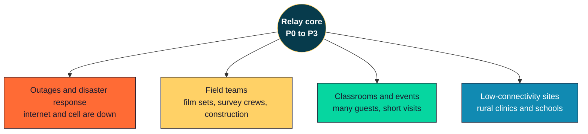

# Relay: end goal and impact

Status: **draft for approval** · 2026-11-17 · This whole page is a proposal for the owner to edit.

## End goal

> **Any group can stand up a trusted private network in under a minute, anywhere, using the
> devices they already carry, and it stays up when links and devices fail.**

"Done" for the vision looks like this: a person opens Relay on a laptop in a place with no
internet, others scan a code to join, and files, messages, and shared folders work across the whole
group. Pull any one cable, walk any one device out of the room, and nobody has to do anything.

## Where it can matter

| Area | The problem today | What Relay needs beyond P3 |
|------|-------------------|----------------------------|
| **Outages and disaster response** | Phones and laptops work, the network between them does not | Multi-hop relaying across devices · store-and-forward messages · "I'm safe" check-in board · broadcast notice from the host · low-power mode |
| **Field teams** | Huge media files moved by passing drives around | Folder sync · transfer queue with priorities · bandwidth limits · verified delivery receipts |
| **Classrooms and events** | Sharing to 30 devices means email, cloud links, or USB sticks | Guest role with time-limited membership · one-to-many send · drop-box folder · QR join |
| **Low-connectivity sites** | One weak uplink, everything depends on the cloud | Share one device's internet with the site · local cache of common files · sync when the uplink returns |

## What all four need (so it goes first after P3)

1. **Android app** on the same core. Phones are the devices people actually carry.
2. **Multi-hop relaying.** Turns "two machines in a room" into "a building" or "a campsite".
3. **Messages and presence.** A network people join needs something to do in the first ten seconds.
4. **Site dashboard.** Who is here, which links are healthy, what moved, exportable audit report.

## How the vision stays honest

- Every roadmap feature names the impact area it serves. No area, no feature.
- The idea agent (`04-agent-system.md`) reviews this page and `NEXT-UPDATES.md` on a schedule and
  proposes changes. The owner approves what moves from "idea" to "planned".
- P0 to P3 does not grow. New ideas land after P3 unless the owner says otherwise.
