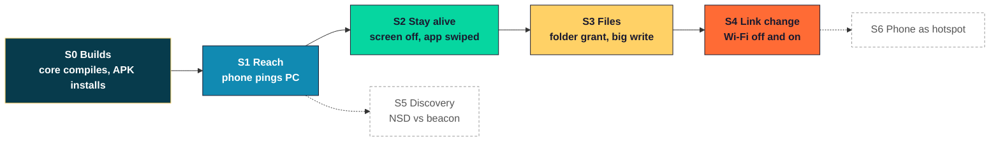
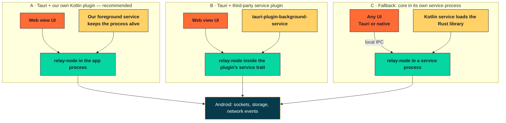
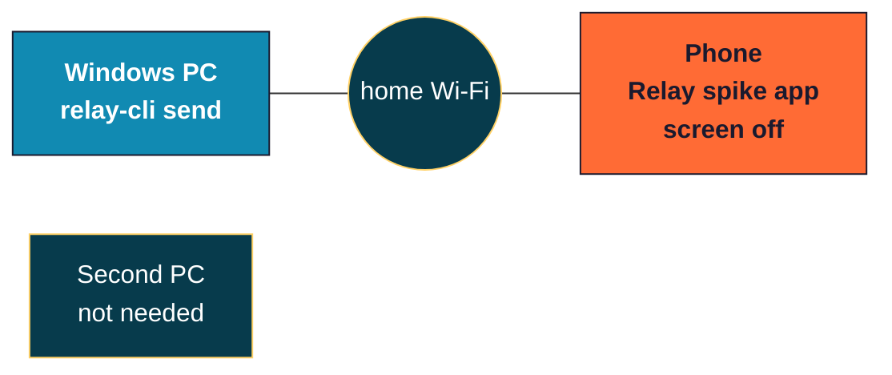

# Relay: the phone side (Android)

Status: **draft for approval** · 2026-11-17 · Items marked **(call)** are proposals.
"(unverified)" means it was not confirmed in a primary source. Sections 5 to 8 (the spike plan)
were added on 2026-11-17 and their sources were read that day.

Test hardware: 2 Windows PCs and 1 phone. Android app is roadmap after P3, but the core must not
block it, and the phone should be useful in testing as early as is sensible.

## 1. What the phone does at each stage

| Stage | Phone role | What is needed |
|-------|-----------|----------------|
| P0 | None. | Nothing. Keep core free of Windows-only code. |
| P1 | None. | Nothing. Test transfers PC to PC. |
| P2 | Optional: a browser or `curl` is not a member. | Nothing. Do not build a web client (**call**). |
| P3 demo (**cheap option, no app**) | A plain Wi-Fi hotspot, the "third link". | The owner turns on the phone's normal hotspot in system settings. Both PCs join it. `link` sees a third interface and fails over to it. No Relay code on the phone. |
| After P3, step 1 | Real member: join, send, receive. | Tauri Android build, foreground service, SAF folder picker, NSD discovery. |
| After P3, step 2 | Host or deputy (hotspot you run yourself). | Local-only hotspot control. Likely not worth it early. |

Why the cheap option first: it exercises the P3 failover with zero Android work and uses the one
phone for a real test. Caveat: a phone hotspot often shares mobile data, so the PCs may also get
internet through it. Relay must treat that as just another path, never as required (matches "works
offline").

Client isolation on some hotspots or routers can block peer-to-peer traffic (unverified). If the
PCs cannot see each other over the phone hotspot, that is a test finding, not a Relay bug.

## 2. How the Rust core reaches Android

Tauri v2 has an Android target. Prerequisites are Android Studio, the SDK, NDK, and these Rust
targets: `aarch64-linux-android`, `armv7-linux-androideabi`, `i686-linux-android`,
`x86_64-linux-android`
([Tauri prerequisites](https://v2.tauri.app/start/prerequisites/)).

Native code goes in a **mobile plugin**: a Kotlin class extending `app.tauri.plugin.Plugin` with
`@TauriPlugin` and `@Command` methods. Rust calls it through `PluginHandle::run_mobile_plugin`,
and Kotlin returns data with `invoke.resolve`. Native commands run on the main thread, so long work
must move to a coroutine. Kotlin can also call Rust over JNI
([Tauri mobile plugins](https://v2.tauri.app/develop/plugins/develop-mobile/)).

```
Tauri UI (web view) ── invoke ──▶ relay-app (Rust)
                                      │ calls only through node
                                  relay-node ─▶ modules ... (pure Rust, same crates as Windows)
                                      │ trait objects
                                  platform traits ◀── Kotlin plugin (NSD, SAF, service, hotspot)
```

| Module | Portable? | Platform piece |
|--------|-----------|----------------|
| common, proto (PR) | yes | None. |
| identity (ID) | yes | Key storage: Android Keystore or app-private files **(call)**. Keys must be loaded through a `KeyStore` trait, not a path. |
| store (ST) | yes, with a path given in | App-private dir from the platform. No hard-coded paths. |
| discovery (DS) | needs platform code | Beacon and mDNS in Rust work in principle. NSD is the supported Android path ([NSD guide](https://developer.android.com/develop/connectivity/wifi/use-nsd)). Kotlin feeds results through a `DiscoverySource` trait. |
| link (LK) | needs platform code | Interface list and change events. Android gives these through `ConnectivityManager.registerNetworkCallback` (`onAvailable`, `onLinkPropertiesChanged`, `onLost`), with no special permission to listen ([reading network state](https://developer.android.com/develop/connectivity/network-ops/reading-network-state)). Hotspot control is separate (section 3). |
| session (SS) | yes | QUIC over UDP runs in Rust. Needs only a bound socket. |
| membership (MB) | yes | Approval prompt goes through the UI, as on desktop. |
| transfer (TX) | needs platform code | Files are content URIs, not paths (section 3). Reads and writes go through a `BlobSource`/`BlobSink` trait. |
| share (SH) | needs platform code | Folder grant maps to a SAF tree URI. Path checks become URI-tree checks. |
| audit (AU) | yes | Uses store. |
| node (ND) | yes | Hosts the foreground-service lifecycle hooks (start, stop, `onTimeout`). |
| app / cli | UI yes, cli no | The same web UI; the CLI is desktop only. |

## 3. Android constraints and the rule each implies

| Constraint | Fact and source | Design rule for the core |
|------------|-----------------|--------------------------|
| Background execution | Doze suspends network access and ignores wake locks while the device is idle. A foreground service stops the app counting as idle for App Standby, but the page does not say foreground services are exempt from Doze ([Doze and Standby](https://developer.android.com/training/monitoring-device-state/doze-standby)). | Treat "process paused or killed" as normal. Sessions and transfers must resume from disk (already in `02-protocol.md`). Never rely on an in-memory-only transfer state. |
| Foreground service | From Android 14 (API 34) each foreground service declares a type plus a type permission. `dataSync` fits file transfer and needs no runtime permission ([service types](https://developer.android.com/develop/background-work/services/fgs/service-types)). | `node` exposes `start()` and `stop()` that a service can call. Show progress as events, so a notification can mirror them. |
| `dataSync` time limit | When targeting Android 15, `dataSync` gets 6 hours per 24 hours in the background. The system calls `Service.onTimeout` and the service must stop within seconds ([timeout](https://developer.android.com/develop/background-work/services/fgs/timeout)). | `node` needs a `pause_all(reason)` that flushes chunk maps fast. A forced stop must never corrupt `.relaypart` state. |
| Nearby permission | On Android 13+ (API 33) Wi-Fi Aware, Wi-Fi Direct and the local-only hotspot need `NEARBY_WIFI_DEVICES`. NSD is not in that list ([Wi-Fi permissions](https://developer.android.com/develop/connectivity/wifi/wifi-permissions)). Below API 33, `ACCESS_FINE_LOCATION` applies. | Permission state is UI and platform business. A module reports `RLY-DS-xxx permission missing` as `Degraded`, never crashes. |
| **Local network permission (new, biggest rule change)** | From Android 17 (API 37), apps that target 37 or higher are blocked from the LAN by default. They need the runtime permission `ACCESS_LOCAL_NETWORK` (in the Nearby devices group) for outgoing and incoming TCP and for sending or receiving UDP unicast, multicast and broadcast. Plain `NsdManager` discovery is affected too. Apps targeting 36 or lower keep access for now through `INTERNET`. A denied TCP connection usually times out and denied UDP usually returns `EPERM` ([local network permission](https://developer.android.com/privacy-and-security/local-network-permission)). | Every Relay packet on the phone depends on one user prompt. Ask for it on first run with a plain reason. Map `EPERM` and "all paths time out right after start" to one clear code (`RLY-LK-xxx local network access not granted`), not a generic network error. |
| Multicast and mDNS | Wi-Fi drivers often filter multicast to save power. `WifiManager.MulticastLock` (needs `CHANGE_WIFI_MULTICAST_STATE`) asks the system to deliver it (unverified, from general knowledge). NSD discovery is costly and should stop when the UI pauses ([NSD guide](https://developer.android.com/develop/connectivity/wifi/use-nsd)). | Discovery sits behind a trait. Keep the signed UDP beacon (already planned), but also support "poll when asked" so the phone can run it briefly. Typed address and QR join must always work. |
| Hotspot control | `startLocalOnlyHotspot` makes a network with no internet access, needs `NEARBY_WIFI_DEVICES` when targeting Android 13+ (`ACCESS_FINE_LOCATION` below that), and is shared if several apps ask for it ([local-only hotspot](https://developer.android.com/develop/connectivity/wifi/localonlyhotspot)). That it exists since API 26 and that the system picks the SSID and password are unverified. | `link` must not assume it can pick the SSID or password. Hotspot is a `HotspotProvider` trait. The Windows one is host-run. The phone one may only return credentials to show or encode in a QR. |
| Scoped storage | The folder picker `ACTION_OPEN_DOCUMENT_TREE` grants a directory tree. It returns URIs, not paths. `takePersistableUriPermission` keeps it across reboots, but the grant is lost if the folder is moved or deleted. The root of internal storage and `Download` cannot be picked ([storage access framework](https://developer.android.com/training/data-storage/shared/documents-files)). | `share` stores a grant as an opaque `GrantRef` plus a display name, not a `PathBuf`. `transfer` reads and writes through byte-stream traits. A stale grant is an error code, and re-asking the user is the fix. |
| Display name vs file name | Display name is provider-specific and may not be the real file name; size may be null (same source). | Offer manifests must not trust name or size from the platform. Size comes from reading, and names are sanitized in `transfer`. |
| Battery | Wake locks and multicast locks cost power (same Doze source). | Heartbeats (250 ms active, 2 s standby, **call** in `02-protocol.md`) need a "low power" profile with longer intervals and a clock injected into `link`. Never hard-code intervals. |

## 4. Do now, P0 to P3

1. Keep every module free of `std::fs` paths and `#[cfg(windows)]` outside one `platform` crate.
2. Put discovery sources, hotspot control, key storage, and file access behind traits in the
   module that uses them. Windows implementations are the first impls, not the only ones.
3. Files are never `PathBuf` in the transfer or share interfaces. Use `BlobSource`, `BlobSink`
   and `GrantRef` (with a Windows impl that wraps paths).
4. All transfer and session state is on disk and safe to kill at any instant. Test it in `sim`
   with a kill at every step.
5. Heartbeat and timeout values come from a config struct, not constants.
6. `node` exposes `pause_all`, `resume_all`, and a progress event stream, so a service wrapper can
   be added without touching modules.
7. Build core crates for `aarch64-linux-android` in CI from P1 on (compile check only). This
   catches desktop-only dependencies early.
8. Never block on a UI approval inside a module. Approvals are events and replies, because the
   phone UI may be gone when they arrive.

## 5. Spike plan: what to prototype first

A spike is a throwaway test that answers one question. Nothing here ships. The order is by
"what would force a redesign if it failed", not by what is easiest.



Solid arrows are the proof of concept. Dashed boxes are measured only if time allows.

| Spike | Question it answers | How, with 1 phone + 1 PC | Pass (**call**) | If it fails |
|-------|---------------------|--------------------------|-----------------|-------------|
| **S0 Builds** | Do the core crates and a Tauri shell build for Android at all? | CI compiles `relay-common`, `proto`, `identity`, `session` for `aarch64-linux-android`. CI also builds a debug APK of an empty Tauri app that links them. The owner installs the APK on the phone. | CI green, app opens and shows the device fingerprint from the Rust core. | A crate needs a desktop-only dependency: swap or feature-gate it now, while the core is small. |
| **S1 Reach** | Can Rust sockets on the phone talk to a PC on the same Wi-Fi, including under the Android 17 permission? | Phone app runs the P0 `relay ping` against the PC by typed IP address. Repeat with local network access denied. | Authenticated ping reply. With access denied, the app shows the specific "local network access not granted" code. | Sockets must be opened in Kotlin and handed to Rust. Costly, so find out first. |
| **S2 Stay alive** | Does the core keep running with the screen off, and after the app is swiped away? | Start a foreground service, then ping once a second for 30 minutes with the screen off and the phone unplugged. Then swipe the app away and watch for 10 more minutes. | No gap longer than 5 s with the screen off. After the swipe, either it keeps running or it stops cleanly and resumes on reopen. | Accept "transfers pause when the phone sleeps" and lean on resume, or move the core into a separate service process (section 6, option C). |
| **S3 Files** | Can Rust read and write big files inside a folder the user picked? | Pick a folder with the system picker. Receive a 1 GB file from the PC into it. Kill the app halfway. Reopen and resume. | Hash matches after the resume. The grant still works after a reboot. | Stream bytes through Kotlin instead of a file handle. Slower, so measure the speed. |
| **S4 Link change** | Does a session survive the phone changing networks? | During a transfer, turn Wi-Fi off for 10 s and on again. Then move the phone between two Wi-Fi networks. | `link` gets the change event, the session reconnects, the transfer resumes without the user doing anything. | The phone is a member that reconnects by hand. Fine for a first release. |
| S5 Discovery (optional) | Which finds the PC faster and more reliably: NSD, or the signed UDP beacon with a multicast lock? | Run both for 5 minutes each, screen on then off. Count the time to first result and the misses. | One of them finds the PC within 5 s with the screen on. | Typed address and QR join remain the fallback, already required. |
| S6 Phone as hotspot (optional) | Can the PC reach the phone when the phone is the hotspot? | Turn on the phone's normal hotspot, join the PC, run the S1 ping both ways. | Ping works both ways. | The phone hotspot only bridges PCs (the section 1 cheap option), and the phone app is not a member in that mode. |

Notes on S2. A `dataSync` service is capped at 6 hours per 24 hours in the background for apps
targeting Android 15+, and the cap resets when the user opens the app
([timeout](https://developer.android.com/develop/background-work/services/fgs/timeout)). The
`connectedDevice` type covers "interactions with external devices that require a ... network
connection", needs `FOREGROUND_SERVICE_CONNECTED_DEVICE`, and is satisfied by declaring
`CHANGE_WIFI_MULTICAST_STATE`, which Relay wants anyway
([service types](https://developer.android.com/develop/background-work/services/fgs/service-types)).
It is not in the 6-hour list. **(call)** S2 tries `connectedDevice` first and `dataSync` second.
Whether an app store would accept `connectedDevice` for this use is unverified, and only matters if
Relay is ever published.

## 6. Which shell to use for the spike

The stack decision (Rust core + Tauri) stands. This is only about how the core is kept alive on
the phone.



| Option | For | Against |
|--------|-----|---------|
| **A. Our own plugin (recommended, call)** | Same structure as the Windows app. We choose the service type and own every line, so a failure points at our plugin. Tauri plugins can declare permissions, get `checkPermissions` and `requestPermissions` for free, and push events to the UI with `trigger` ([mobile plugins](https://v2.tauri.app/develop/plugins/develop-mobile/)). | We write the service ourselves. Whether the Rust side keeps running once the screen that hosts the web view is destroyed is unverified. S2 tests exactly this. |
| B. Third-party plugin | [tauri-plugin-background-service](https://docs.rs/tauri-plugin-background-service) 1.0.1 already wraps an Android foreground service with a notification and auto-restart. | Not an official Tauri plugin, one maintainer, and its docs do not say which service type it declares. Use it as a reference to read, not a dependency. |
| C. Separate service process | The core survives the UI being destroyed, by construction. | UI and core talk over IPC, which Windows does not need. Only worth it if S2 fails on A. |

## 7. Minimal proof of concept

One sentence: **the phone receives a 1 GB file from a PC with its screen off, survives the Wi-Fi
being toggled, and the hash matches.** That is S0 to S4 joined together.



| In | Out |
|----|-----|
| One screen: fingerprint, typed peer address, one progress bar, one module health strip | Final UI design, QR join, any styling beyond readable |
| P0 session and P1 transfer from the shared crates, unchanged | Membership, grants, audit (P2) on the phone |
| Foreground service with a progress notification | Phone as host or deputy, hotspot control |
| Folder picker and one persisted folder grant | Sending from the phone, browsing folders |
| Local network permission prompt and its error code | Wi-Fi Direct, Wi-Fi Aware, Bluetooth |
| Debug APK built in CI, installed by hand | Play Store, signing, iOS |

**When to run it.** S0 can start as soon as P0 has a working `relay ping` (it is only a CI job).
S1 needs P0 done. S2 needs nothing more. S3 and S4 need the P1 transfer. So the proof of concept
lands right after P1, not after P3, and costs P2 and P3 nothing because it runs on its own branch.
**(call)**

**Who does what.** Agents write the code and CI builds the APK in the cloud. Two steps need the
owner, because they need the physical phone: installing the APK, and running the five tests while
noting pass or fail. A one-page test sheet comes with the APK.

## 8. Risks

Ordered by how much redesign each would cause.

| # | Risk | Likelihood | Impact | Caught by | Plan if it happens |
|---|------|-----------|--------|-----------|--------------------|
| 1 | The user denies local network access, or a later Android version tightens it further. | Medium | The app can do nothing. | S1 | Clear error code and a "grant access" button. There is no technical way around it, by design. |
| 2 | The Rust core dies when the web view screen is destroyed, even with a foreground service. | Unknown (unverified) | Transfers stop on swipe-away. | S2 | Option C, or accept pause-and-resume. |
| 3 | The phone maker's battery saver kills the service anyway. | Medium on some brands (unverified, depends on the phone) | Same as 2, but only on that phone. | S2 on the real phone | Resume from disk, plus a settings hint for that brand. |
| 4 | A core dependency does not build for Android (crypto or QUIC library). | Low to medium (unverified) | Days of rework if found late, hours if found now. | S0 | Feature-gate or swap the crate. This is why the CI compile check starts at P1 at the latest. |
| 5 | Writing through a folder grant is far slower than a normal file. | Medium (unverified) | Slow receives on the phone. | S3 | Write to app-private storage first, then move into the granted folder. |
| 6 | Multicast is filtered, so the beacon and mDNS miss peers. | Medium (unverified) | Discovery is flaky. Joining is not blocked. | S5 | NSD, and typed address or QR as the always-works path. |
| 7 | Home routers or the phone hotspot isolate clients. | Low at home, higher on public Wi-Fi (unverified) | Phone and PC cannot see each other on that network. | S1, S6 | Not fixable in software. Report it as a clear `link` error. |
| 8 | The 6-hour `dataSync` cap interrupts a very long transfer. | Low | A pause until the user opens the app. | S2 | `connectedDevice` type, and `pause_all` on `onTimeout` (section 4, item 6). |
| 9 | Tauri's Android tooling changes under us. | Low | Build breaks. | S0 in CI | Pin the Tauri version in the spike. |

Deliberately left out of the spike: **Wi-Fi Direct, Wi-Fi Aware and Bluetooth.** They need the
nearby-devices permission (section 3) and, more importantly, whether Windows and Android can form
such a link with each other is still an open "Tech watch" item in `NEXT-UPDATES.md`. A spike that
depends on an unanswered question is two spikes. They get their own once S0 to S4 pass.

## 9. Open questions for the owner

1. Which phone model and Android version is the test phone? (It decides which permission and
   foreground-service rules apply in practice.)
2. Is a phone hotspot with no app enough for the P3 demo, with a real Android member after P3?
3. Does the phone's hotspot allow devices to reach each other, or does it isolate clients? A
   five-minute test with two PCs would show it.
4. Is the Android member app required for the resume story, or is a working host-on-Windows demo
   plus a documented Android plan enough?
5. Is it fine to run the phone proof of concept right after P1 (on its own branch), instead of
   waiting until after P3?
6. Are you willing to install a debug APK on the phone and run a one-page test sheet? That is the
   only part that cannot be done from the cloud.
