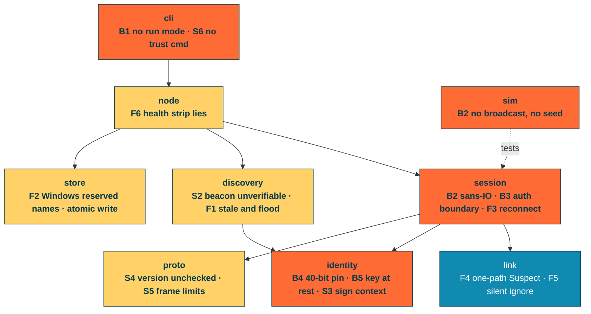
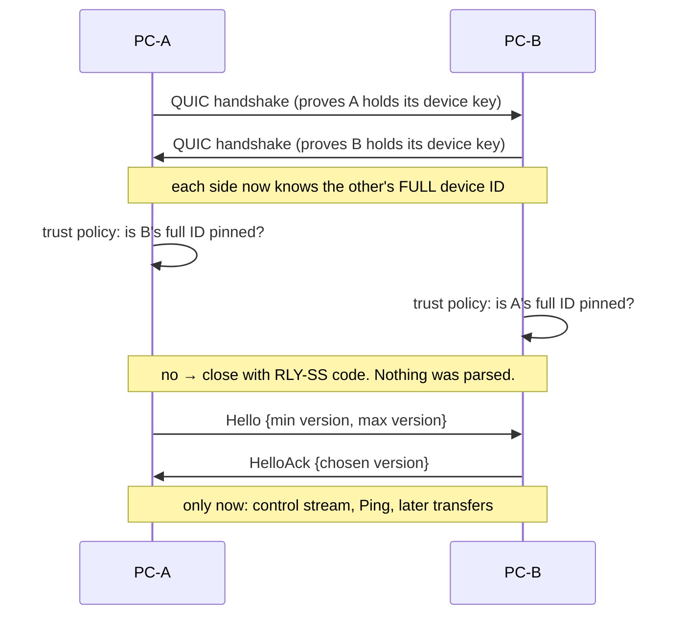

# Relay: P0 readiness review (security and failure modes)

Reviewer: design reviewer · 2026-11-17 · Reviewed at commit `ae31b3e` on `claude/project-thread-t5x7gf`

**Scope.** The P0 code that exists today (`crates/relay-*`), plus the parts of the revised design a
P0 builder will work from (`02-protocol.md` sections 1, 2, 4, 6, 9; `03-phases.md` P0; the test
plan's P0 rows). The **P0 implementation plan was not pushed yet**, so section 6 is the list of
questions it will be checked against. This file gets a "Plan review" section when the plan lands.

**Verdict.** The skeleton is clean and the revised protocol closed the big join, handoff and
failover holes. P0 is **not ready to cut into builder tasks** yet: 5 decisions are missing where a
wrong guess becomes a security hole or a rewrite. None is large. All 5 fit on one page of the plan.

Baseline checked: `cargo test --workspace` passes on this commit (60 tests, 0 failed).

## 1. Where the findings land

Orange = blocker (decide before tasks are cut) · yellow = high · blue = medium.

## 2. Blockers: decide these before P0 tasks are cut

| ID | Where | Gap | If a builder guesses wrong | Suggested answer |
|----|-------|-----|----------------------------|------------------|
| **B1** | `relay-cli`, `03-phases` P0 exit test | The CLI has only one-shot commands (`init`, `peers`, `ping`, `health`). Nothing keeps a node running, yet PC-B must be listening to answer PC-A's ping, and discovery needs seconds of listening. Daemon plus client, or one foreground `relay run`? | A daemon with a localhost TCP control port lets **any local program or web page** drive the node, including `trust`. A per-command node cannot answer pings at all. | P0: one foreground `relay run` process owns the node. Other commands talk to it over a **Windows named pipe restricted to the current user**. No TCP control port. |
| **B2** | `relay-session`, `relay-sim`, "done" rule 2 in `03-phases` | `SimNet` moves raw packets between `DeviceId`s in virtual time. Real QUIC needs sockets, a real clock and randomness. Nothing says how the real session runs inside the sim. Also `SimNet::send` needs a `to`, so a **broadcast beacon cannot be simulated**, and the P0 scenario "Discover and ping" cannot be written. | Sim tests end up exercising a fake session, so "passes in sim" proves nothing about the code that ships. Or the session is built on sockets first and must be rewritten. | Build session as a sans-IO state machine (packets in, packets out, clock and random source passed in) so the same code runs on UDP and on `SimNet`. Add `broadcast(from, via, bytes)` and a seed to `SimNet`. Settle the open Tech-watch item "existing Rust peer-to-peer library" first, because it decides this. |
| **B3** | `02-protocol` §4, `relay-session` | "Both sides prove they hold their device keys" has no mechanism (self-signed certificate with a custom verifier, or raw public keys), and no rule for **what is parsed before the trust policy says yes**. `Hello`/`HelloAck` exist in `proto` with no stated place in that order. The `Session` trait has no trust-policy type, no receive path and no events. | Frames from strangers get parsed and buffered before authentication (up to 4 MiB each, see S5). Or the policy is checked after streams open, so an unpinned peer gets a working channel for a moment. | See the diagram in section 3. Rule: **zero Relay frames are read from a peer until the handshake has proved its key and the trust policy has accepted its full device ID.** Put the `TrustPolicy` trait in the plan with the pin list as its first implementation. |
| **B4** | `relay-identity::Fingerprint`, `02-protocol` §4 table | P0 and P1 trust is "the peer's fingerprint is on the pinned list". A fingerprint is **40 bits** and `Fingerprint::matches` is a prefix match. | An outsider on the Wi-Fi can generate keys until one has the same 8 characters as a pinned device (about 10^12 tries, days on one PC by my estimate, not measured). It then passes the trust policy as that device. This is the whole of P0 and P1 security. | The fingerprint stays as the thing people read. `relay trust K7QF-2M9X` must resolve it to the **full 32-byte device ID** of a device seen right now, store the full ID, and the policy compares full IDs. Two visible devices with the same fingerprint is an error code, not a pick. |
| **B5** | `relay-identity`, `relay-store`, `02-protocol` §1 | The design says where the **site** key lives. Nothing says where the **device** secret key lives, how it is protected, or what `relay init` does when a key already exists or the key file is damaged. `DeviceKeyPair` has no load or save path and identity depends on nothing. | Key saved as plain bytes in the config store. Or `relay init` run twice quietly makes a new key, the fingerprint changes, and every pin on other machines breaks with no clear error. | Key goes through a `KeyStore` trait (already required by `07-android.md` §2). Windows implementation uses the OS user-bound protection. `relay init` **refuses to overwrite**; a damaged key is an `RLY-ID` error and never an automatic regenerate. Wipe secret bytes on drop. |

## 3. The authentication boundary (B3)

Limits the plan should state for the listening port: maximum handshakes in progress, a handshake
timeout, and a timeout for a frame that starts but never finishes.

## 4. Security findings (not blockers, fix inside P0)

| ID | Sev | Where | Gap | Suggested answer |
|----|-----|-------|-----|------------------|
| S2 | High | `02-protocol` §2, `relay-discovery::Beacon` | The beacon is "signed by the device key", but the struct carries **no signature and no public key**. A device ID is a hash, so a receiver cannot check the signature. There is also no freshness value, so a recorded beacon can be replayed later from another address. | Simplest honest option: in P0 the beacon is an **unsigned hint** and the handshake is the only proof. Say so in §2. If it stays signed, add public key, signature and a counter, and keep every address seen for a device instead of "last one wins". |
| S3 | High | `relay-identity::sign`, `Signed<T>` | One device key will sign beacons, the handshake, later certificates and audit checkpoints. `sign(key, message)` has no purpose label and "the encoded body" has no defined encoding. | `sign(key, context, message)` with a fixed label per use (`relay/beacon/v1`...). One written encoding for signed bodies in `proto`. Cheap now, a wire break later. |
| S4 | High | `relay-proto::Frame::decode` | `version` is read and never checked. A frame claiming version 9 is parsed as version 1. "Unknown types are skipped" also applies during the handshake. | Version is agreed once in `Hello`. A frame with any other version is an `RLY-PR` error. Unknown types are skipped only after the handshake. |
| S5 | Medium | `relay-proto::MAX_FRAME_LEN` | One limit, 4 MiB, for every frame. P0 only has `Hello` and `Ping`. | Per-type limits. Control frames 64 KiB at most in P0. |
| S6 | Medium | `relay-cli`, `03-phases`, test plan | `03-phases` and the runbook use `relay trust <fingerprint>`. The CLI has no `trust`, no way to list pins and no way to remove one. Nothing says a live session is dropped when its pin is removed. | Add `trust`, `trust --list`, `untrust`. Removing a pin closes that peer's session at once. This is the same path revocation uses in P2. |
| S7 | Medium | `02-protocol` §9, `03-phases` setup note | "Asks before adding a firewall rule" does not say how a CLI asks, or the rule's reach. Adding a rule needs administrator rights. | P0: print the exact rule and let the owner run it. Never self-elevate. Rule = this program, UDP, local subnet only. |
| S8 | Low | `relay-proto::FrameType` | `FrameType::Unknown(1)` encodes as `Hello`. The value can be built by hand. | Reject known numbers inside `Unknown` when encoding, with a test. |

## 5. Failure-mode findings

| ID | Sev | Where | Gap | Suggested answer |
|----|-----|-------|-----|------------------|
| F1 | High | `relay-discovery` | No last-seen time or expiry on a sighting, so a peer that left stays in `relay peers` for ever. No cap on the table, so a flood of fake beacons grows memory without limit. The same device seen by mDNS, by beacon and on two interfaces has no merge rule. | Sighting gets `last_seen` and the local interface it arrived on. Drop after 3 missed beacons (6 s). Cap the table (for example 256) with an `RLY-DS` code when full. One peer, many addresses. |
| F2 | High | `relay-store::Key`, `FileStore` | `Key::new` accepts `con`, `nul`, `aux`, `com1`, `lpt1`. Windows cannot create files with those names. It also accepts a trailing dot (`a.`), which Windows strips, so `a.` and `a` become one file. No length limit. `FileStore` has no stated rule for a crash mid-write, a damaged file, or two processes on one folder. Stored values carry no format version. | Reject reserved names and trailing dots, cap length, with tests. Write = temporary file, flush, rename. Damaged file = `RLY-ST` code, never a panic and never a silent reset. A lock file per data folder. First byte of every stored value is a format version. |
| F3 | High | `relay-session` | "A session outlives any single connection" has no rules: which side redials (both doing it makes two connections), the retry timing, who picks the `SessionId`, what happens when the peer restarted and forgot the session, and whether a control message sent just before a drop is delivered. | Lower device ID dials. Backoff 250 ms doubling to 5 s. Session ID is random, chosen by the dialer; an unknown ID on reconnect starts a fresh session. Control messages are **not** replayed, callers ask again. P1 resume depends on that last line. |
| F4 | Medium | `relay-link`, test plan P0 "Slow link" | "Missed heartbeat" is not defined (no reply within one interval, or a count of unanswered ones). With one path, Suspect has nothing to switch to. A jump from 5 ms to 800 ms delay gives about 1.6 s with no replies, which is Suspect under either reading. | Define a miss as "no reply within the larger of 250 ms and 2 x recent round trip". With one path, Suspect only raises `Degraded` and keeps trying. |
| F5 | Medium | `relay-link::PathState::on_event` | Any event not in the diagram is silently ignored. The diagram has no way for a standby path to go down, or for a recovered path to become standby, though §6 says it does. The timings are constants, while `07-android.md` §4 rule 5 says they come from a config struct. The `Promoted` comment still says "went down" (now "is suspect"). | Return an error for an impossible transition. Add the missing arrows before P3 builds on this. Move the four timings into a config struct now, while only tests use them. |
| F6 | Medium | `relay-node::HealthBoard`, `relay-cli` | `relay health` prints a brand-new board, so it shows every module healthy whatever is true. Unbuilt modules also show as healthy. `last_code` never clears after recovery. | Until a node is running, `relay health` says so. Add a "not built" state. Clear the code line when all modules are ok. This strip is the "one failure can be identified" promise, so it must not show green by default. |
| F7 | Medium | `02-protocol` §2, bench in the test plan | No decision on one fixed UDP port or a free one, on IPv4 or IPv6, or on two Relay copies on one PC. A direct Ethernet cable between two PCs is an "unidentified network", which Windows treats as **Public** by default ([Microsoft](https://learn.microsoft.com/windows/security/operating-system-security/network-security/windows-firewall/#concepts)), so a firewall rule for Private only will not open that path. | Free port carried in the beacon, fixed discovery port, `--data-dir` so two copies run on one PC (this also gives the 2-PC bench a third node later). Add a runbook step to check the cable's network profile before the P0 test. |
| F8 | Low | test plan "Three levels" | "Run 20 times to catch timing flakes" and "each scenario must give identical event logs" cancel out: a deterministic sim gives the same result 20 times. | 20 different seeds for jitter and ordering, and each seed must replay identically. |
| F9 | Low | workspace `Cargo.toml` | Only `thiserror` is chosen. QUIC, signatures, hashing, randomness, mDNS and the async runtime are all open. | List them in the plan with one line each on why. Add a dependency audit step to CI when they land. |

## 6. What the P0 plan will be checked against

**Basic (every task in the plan)**

- [ ] Names one module and its files. No two tasks own the same file.
- [ ] States the failing test written first and the `RLY-` codes it adds.
- [ ] A builder could start without asking anyone (B1 to B5 answered in writing).

**Advanced (tasks touching keys, the wire, disk, or the listening port)**

- [ ] Says what an unpinned stranger on the same Wi-Fi can send, and what happens to each byte.
- [ ] Says what happens on: process killed at any line, damaged file, port busy, second copy
      running, peer restarted, firewall says no.
- [ ] Every size from the network has a limit, and every wait has a timeout.
- [ ] The same code path runs in `sim` and on real sockets, or the plan says which part does not.
- [ ] No step changes a setting on the owner's PC. Anything that needs one is printed for him to run.

## 7. Still open from the cold read of the design (not P0)

Raised once here so they are not lost. Each needs an answer before its phase is planned.

| Phase | Where | Open point |
|-------|-------|-----------|
| P1 | `02-protocol` §5 | The offer's `name` comes from the sender. Nothing says it is cleaned before use, so `..\..\Startup\x.exe` is a write outside the download folder. No rule for who may send to whom, whether accept is automatic, a free-space check, a name that already exists, or a retry cap on a chunk that keeps failing. |
| P2 | `02-protocol` §5 and §8 | Transfer is push only. No message lets a member **fetch** a file it found by browsing, and `share` and `transfer` cannot call each other. |
| P2 | `02-protocol` §1 | 30-day certificates and grant expiry need correct clocks. Offline devices have no time source. No tolerance is stated. |
| P3 | Test plan P3 step 4, `07-android.md` §1 | "Fails over to the phone hotspot within 3 s" and "`link` sees a third interface" assume a PC can be on home Wi-Fi and the phone hotspot together. A PC with one Wi-Fi radio joins one network at a time, so this is a network change by the user, not a failover. `03-phases` was corrected; these two were not. |
| P3 | `02-protocol` §7 | "Host silent for 10 s": seen by whom? Two deputies both end at epoch E+1, so "higher epoch wins" (test plan) cannot pick one; the `priority` field must. If the host ran the hotspot, the network is gone with it and no deputy can be reached. |

## 8. Checklists run for this review

- Basic: could a builder plan P0 without asking? **No**, 5 gaps where a wrong guess matters (B1 to B5).
- Advanced, contradictions: `07-android.md` §4 rule 5 vs constants in `relay-link` (F5); runbook
  `relay trust` vs CLI (S6); beacon "signed" vs `Beacon` struct (S2); test plan P3 step 4 vs
  `03-phases` (section 7).
- Advanced, upward calls: none found. The trust-policy snapshot rule in `01-architecture.md` holds.
- Not checked: the P0 plan (not pushed), the UI design doc (in progress), real behaviour on
  Windows hardware (owner's bench only). The key-grinding time in B4 is an estimate.
