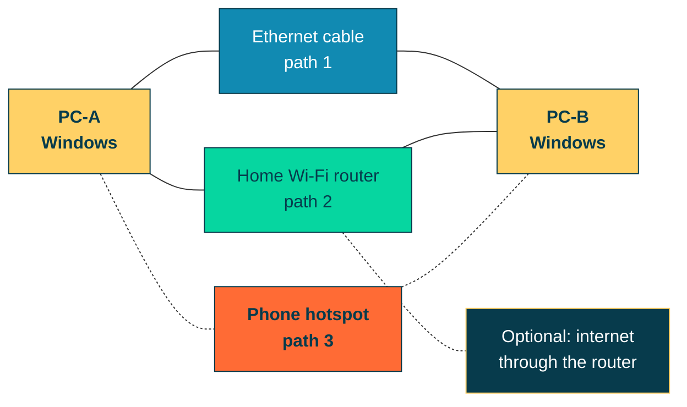

# Relay: test plan

Status: **draft** · 2026-11-17 · Covers P0 to P3 from `docs/design/03-phases.md`.

## Three levels

| Level | Where | Clock and network | Who runs it |
|-------|-------|-------------------|-------------|
| 1. Unit | Each crate's `#[cfg(test)]` | Fake clock, in-memory transport, no sleeps | Agents, every change |
| 2. Sim scenarios | `crates/relay-sim` plus scenario tests | Virtual time, scripted links (drop, delay, kill, drop pattern) | Agents, CI; run 20 times to catch timing flakes |
| 3. Real hardware | The owner's bench | Real NICs, real Wi-Fi, a phone | **The owner, by hand. Agents never touch the owner's computers.** |

A phase is done only when its level 3 exit test passes AND the matching level 2 scenario passes
in CI. Every new `RLY-` code needs a test that triggers it.

## Sim scenarios

Nodes are `DeviceId`s in one `SimNet`. "Two paths" means two links between the same pair
(for example an Ethernet link and a Wi-Fi link), the failover precondition.

| Phase | Name | Setup | Action | Pass condition |
|-------|------|-------|--------|----------------|
| P0 | Discover and ping | 2 nodes, 1 link, 5 ms | Run discovery, then ping | Each lists the other; ping reply arrives at t = 2 x delay |
| P0 | Slow link | 2 nodes, 1 link | Set delay 5 ms to 800 ms mid-ping | Ping still succeeds; no false `PathDown` below the timeout |
| P0 | Peer restart | 2 nodes, pinned | Kill B, advance, revive B | A reports B down, then reconnects without re-pinning |
| P1 | Link drop mid-transfer | 2 nodes, 1 link, 100 MiB file | Link down at 50%, up 2 s later | Transfer resumes from the chunk map; hash matches; no chunk re-sent that was verified |
| P1 | Receiver restart | 2 nodes, 1 link | Kill receiver at 50%, revive | Resume asks only for missing chunks; hash matches |
| P1 | Lossy link | drop every 7th packet | Send 100 MiB | Completes; hash matches |
| P1 | Corrupt chunk | 2 nodes | Flip a byte in one chunk | Chunk rejected and re-requested; final hash matches |
| P2 | Unapproved device | 3 nodes, host + member + stranger | Stranger asks for roster and files | Gets nothing; the denial is in the audit log |
| P2 | Revocation | 3 nodes | Host revokes member, member reconnects | Dropped; no file access afterwards |
| P2 | Grant boundary | host shares folder X | Member reads X, then reads outside X | First succeeds, second refused; both audited |
| P2 | Audit tamper | log with 10 entries | Edit entry 5 | Chain check names entry 5 |
| P3 | Failover on link drop | A and B, Wi-Fi + Ethernet, transfer running | Wi-Fi down at t = 1000 | Transfer continues on Ethernet within 3000 ms; hash matches |
| P3 | Slow link preferred away | A and B, two links | Wi-Fi delay 20 to 1500 ms | Traffic moves to the better link; moves back after recovery (no flapping) |
| P3 | Both paths lost then back | A and B, two links | Both down 5 s, then one up | Session resumes on that link; transfer completes |
| P3 | Host loss | host + 2 deputies + member | Kill host | One deputy becomes host within the takeover limit; epoch + 1 |
| P3 | Two deputies step up | host + deputies D1, D2 | Kill host; delay the D1/D2 link so each sees only silence | Exactly one host at the end; higher epoch wins; the other steps down |
| P3 | Old host returns | as above, then revive old host | Old host sends with old epoch | Rejected; it rejoins as a member |
| P3 | Planned handoff | host + deputy, transfer running | Owner hands off | Transfer unaffected; epoch + 1; one host throughout |

Rule: each scenario runs twice and must give identical event logs (determinism check).

## Real-hardware runbook (owner runs by hand)

**Agents never touch your computers.** Nothing below is run by an agent, and nothing changes
your system settings unless you choose to. If a step needs a settings change (turning Wi-Fi off,
starting the phone hotspot), you do it yourself, and you can stop at any step.

### Bench

Setup: PC-A and PC-B on one Ethernet cable (direct or via a switch) and on the same Wi-Fi. The
phone hotspot is a third path; join both PCs to it only when a step says so. Internet is optional.
Note each PC's name and fingerprint (`relay init` prints it).

### Before every run

1. Close big downloads. Note the Relay build used.
2. Keep the logs open on both PCs (`relay` health strip or log file).
3. Record: date, build, PASS or FAIL per step, and the last `RLY-` code seen.

### P0 Foundation (exit test)

| # | Do | Watch | Pass | Fail |
|---|----|-------|------|------|
| 1 | On both PCs run `relay init` | Fingerprint printed, no error | A short fingerprint like `K7QF-2M9X` on each | Any `RLY-ID-` code |
| 2 | Pin each other's fingerprint with the pin command | Confirmation on both | Both say pinned | Mismatch or `RLY-` code |
| 3 | On PC-A run `relay peers` | Peer list | PC-B appears within about 5 s | Empty list after 15 s |
| 4 | Run `relay ping <PC-B>` | Reply line | Authenticated, encrypted reply | Timeout, or reply marked unauthenticated |
| 5 | Unplug Ethernet, ping again | Reply | Still works over Wi-Fi (bonus for P0) | Note it; failover is formally P3 |

### P1 Transfer (exit test)

| # | Do | Watch | Pass | Fail |
|---|----|-------|------|------|
| 1 | Make a 1 GB test file; note its hash | Hash value | Hash recorded | n/a |
| 2 | Send it from PC-A to PC-B | Progress bar and events | Progress moves; speed is steady | Stalls at 0% |
| 3 | At about 50%, close the receiving app (task manager end task is fine) | Sender state | Sender reports the peer lost | Sender crashes |
| 4 | Restart the receiver and Relay | Resume prompt or auto resume | Resumes near 50%, not from 0% | Starts over |
| 5 | Wait for completion; hash the received file | Hash | Equal to step 1 | Different, or `RLY-TX-` code |
| 6 | Reboot the receiver mid-transfer and repeat 4 and 5 | Same | Same | Same |

### P2 Trust (exit test)

| # | Do | Watch | Pass | Fail |
|---|----|-------|------|------|
| 1 | On PC-A create a site and share one test folder | Site created | Roster shows PC-A as host | Any `RLY-MB-` code |
| 2 | Before approving PC-B, try to list files from PC-B | Output | Nothing: no roster, no files | Any file name visible |
| 3 | PC-B asks to join; compare the 6-digit codes | Both screens | Same code on both; approve on PC-A | Codes differ (deny, record) |
| 4 | PC-B browses the shared folder | Listing | Files visible | Empty or error |
| 5 | PC-B tries a path outside the share | Result | Refused | Anything readable |
| 6 | Check the audit log on PC-A | Entries | Both the browse and the refusal appear | Missing entries |
| 7 | Edit one line in the audit file, run the verify command | Verify output | Tampering detected, entry named | Verify says OK |
| 8 | Revoke PC-B, try to browse | Result | Refused | Still works |

### P3 Self-heal (exit test, the resume demo)

| # | Do | Watch | Pass | Fail |
|---|----|-------|------|------|
| 1 | Start a 1 GB transfer over Wi-Fi with Ethernet also connected | Active path shown | Transfer running | n/a |
| 2 | Switch Wi-Fi off on the sender (your own action) | Path indicator, speed | Switches to Ethernet; stall under 3 s; no restart | Stall over 3 s or restart |
| 3 | Hash the result when done | Hash | Equal to source | Differs |
| 4 | Repeat with Ethernet unplugged and the phone hotspot on both PCs | Path indicator | Fails over to hotspot within 3 s | Transfer dies |
| 5 | Set up a deputy, then shut down the host PC (normal shutdown) | Deputy screen | Deputy becomes host; epoch goes up by one; no input from the owner | No host after 30 s |
| 6 | Bring the old host back | Roster | It rejoins as a member, not as a second host | Two hosts shown |
| 7 | Run a planned handoff while a transfer runs | Transfer and roles | Transfer unaffected; roles swap | Transfer interrupted |

### After a run

Record results in `docs/testing/` as a dated note. Any FAIL becomes a sim scenario first (so it
can be reproduced without hardware), then gets fixed.
